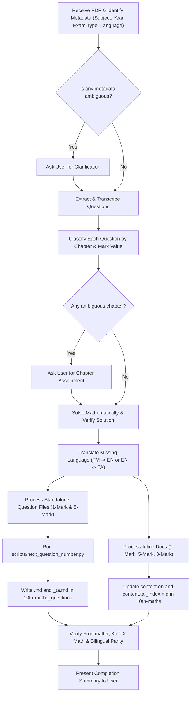

# Exam PDF Parser Skill

Parses scanned, printed, or digital exam-paper PDFs (such as Tamil Nadu Board Public, Quarterly, Half-Yearly, or Midterm Question Papers) into the project's bilingual (English + Tamil) structure across textbook documentation and standalone question bank repositories.

---

## 1. Repository Ecosystem & Destination Mapping

Each subject in this ecosystem spans two synchronized repositories, adhering to the **Gurukulams Design System**:

| Subject | Documentation Repository (Textbook) | Question Bank Repository | Subject Key | Chapters |
|---|---|---|---|---|
| **10th Maths** | `10th-maths/` | `10th-maths_questions/` | `maths` | `relations-and-functions`, `numbers-and-sequences`, `algebra`, `geometry`, `coordinate-geometry`, `trigonometry`, `mensuration`, `statistics-and-probability` |
| **10th Science** | `10th-science/` | `10th-science_questions/` | `science` | Match chapter directories in `10th-science_questions/questions/science/*/` |
| **10th Social Science** | `10th-social/` | `10th-social_questions/` | `social` | Match chapter directories in `10th-social/content.en/docs/*/` |

### Detailed File Destinations for 10th Maths

For any given question paper, questions are routed strictly based on their type and mark value:

| Mark Value & Type | Destination in Docs (`10th-maths`) | Destination in Question Bank (`10th-maths_questions`) |
|---|---|---|
| **1 Mark (MCQ)** | **Do NOT add to docs** (MCQs belong exclusively in the question bank) | Standalone files: `questions/maths/<chapter>/<n>.md` (EN) and `<n>_ta.md` (TA) |
| **2 Marks (Short Answer)** | Inline under `## Board Examination Questions` -> `### 2 Marks` in `content.en/docs/<chapter>/_index.md` & `content.ta/docs/...` | **Do NOT add to question bank** |
| **5 Marks (Long Answer)** | Inline under `## Board Examination Questions` -> `### 5 Marks` in `content.en/docs/<chapter>/_index.md` & `content.ta/docs/...` | Standalone files: `questions/maths/<chapter>/<n>.md` (EN) and `<n>_ta.md` (TA) |
| **8 Marks (Geometry / Graph)** | Inline under `## Board Examination Questions` -> `### 8 Marks` in `content.en/docs/<chapter>/_index.md` & `content.ta/docs/...` | **Do NOT add to question bank** |

---

## 2. Markdown Syntax & Gurukulams Design System Standards

The markdown file syntax follows the standards documented in `design-system/exampleSite/content.en/docs/practices/` (specifically `choose-the-best.md`, `multi-choice.md`, and `mathematical-expressions.md`).

### A. Standalone Question Files (`10th-maths_questions/questions/maths/<chapter>/`)

#### Format for 1-Mark MCQs (`choose-the-best`)
Reference: `10th-maths_questions/questions/maths/relations-and-functions/18.md`

```markdown
---
tags:
  - public
  - <exam-type>
  - '<year>'
  - 1-marks
choices:
  - <distractor 1>
  - <distractor 2>
  - <distractor 3>
answers:
  - <correct answer>
---

## <Question text without leading number>

---

#### <Truth-based mathematical reasoning and step-by-step proof>
```

**Formatting Rules for MCQs:**
1. **Option stripping**: Strip letters `(A)`, `(B)`, `(C)`, `(D)` and `(அ)`, `(ஆ)`, `(இ)`, `(ஈ)`. Only retain the pure option expression/text.
2. `choices:` contains **only the 3 incorrect options (distractors)**.
3. `answers:` contains **the 1 correct answer**.
4. Preserved LaTeX: Math expressions must be delimited by single `$ ... $` (inline) or `$$ ... $$` (block).
5. Headings: Level 2 heading `## ` for question statement, exactly one horizontal rule `---`, followed by Level 4 heading `#### ` for explanation/reasoning.

#### Format for 5-Mark Questions (Question Bank)
Reference: `10th-maths_questions/questions/maths/relations-and-functions/22.md`, `coordinate-geometry/46.md`

```markdown
---
tags:
  - public
  - <exam-type>
  - '<year>'
  - 5-marks
answers: # Include only if there is a concrete final scalar/equation result
  - '$2x + 5y + 6 = 0$'
---

## <Question text without leading number>

---

#### <Full step-by-step mathematical proof / worked derivation>

**Answer:**
$$\mathbf{<final result>}$$
```

**Numbering Rules:**
- Run `python3 scripts/next_question_number.py <questions-repo>/questions/<subject>/<chapter>` to determine the next sequential integer `<n>`.
- Write `<n>.md` for English and `<n>_ta.md` for Tamil.
- Both language files share the identical integer number `<n>` and frontmatter `tags:`.
- **Never renumber or overwrite existing files.**

---

### B. Inline Questions in Documentation (`10th-maths/content.*/docs/<chapter>/_index.md`)

Reference: `10th-maths/content.en/docs/relations-and-functions/_index.md`, commit `133a7e5`

#### English Structure (`content.en/docs/<chapter>/_index.md`):
```markdown
## Board Examination Questions

### 2 Marks

#### 2025

<Question text with LaTeX preserved>

<details class="not-annotatable border rounded p-3 my-3 bg-light-subtle">
<summary class="not-annotatable fw-bold text-primary" style="cursor: pointer;" onclick="event.stopPropagation();">View Model Answer & Solution</summary>

<div class="pt-3">

<Step-by-step solution derivation>

**Answer:**
$$\mathbf{<final answer>}$$

</div>

</details>

---

### 5 Marks

#### 2025

...
```

#### Tamil Structure (`content.ta/docs/<chapter>/_index.md`):
```markdown
## அரசு பொதுத்தேர்வு வினாக்கள் (Board Examination Questions)

### 2 மதிப்பெண் வினாக்கள் (2 Marks)

#### 2025

<தமிழ் வினா உரை>

<details class="not-annotatable border rounded p-3 my-3 bg-light-subtle">
<summary class="not-annotatable fw-bold text-primary" style="cursor: pointer;" onclick="event.stopPropagation();">மாதிரி விடை மற்றும் தீர்வு</summary>

<div class="pt-3">

<படிநிலைகளுடன் கூடிய தீர்வு>

**விடை:**
$$\mathbf{<இறுதி விடை>}$$

</div>

</details>

---

### 5 மதிப்பெண் வினாக்கள் (5 Marks)

#### 2025

...
```

**Placement & Grouping Rules in Docs:**
1. Headings:
   - Check if `## Board Examination Questions` / `## அரசு பொதுத்தேர்வு வினாக்கள் (Board Examination Questions)` exists. If not, add at the end of the file.
   - Inside it, check for mark headings: `### 2 Marks`, `### 5 Marks`, `### 8 Marks` (or Tamil equivalents).
   - Inside each mark heading, check for the year subheading: `#### <year>`.
   - If the `#### <year>` subheading exists, append the question before the next section. If not, insert it maintaining ascending year order.
2. Collapsible Container: Use the exact `<details>` and `<summary>` scaffolding classes shown above (`not-annotatable border rounded p-3 my-3 bg-light-subtle`).
3. Divider: Every question ends with a standalone `---` rule.

---

## 3. Translation & Language Parity Protocol

Every question extracted must exist 1:1 in both English and Tamil.

### Case 1: Tamil-Medium (TM) PDF
Many question papers (e.g. `qb/*_TM_*.pdf`) are in Tamil only:
1. **Transcribe Tamil**: Transcribe the Tamil question statement, options, and solution accurately.
2. **Translate to English**:
   - Translate prose and mathematical problem statements into fluent, standard Tamil Nadu textbook English.
   - Use standard mathematical terminology:
     - சார்பு $\to$ function
     - உறவு $\to$ relation
     - கார்டீசியன் பெருக்கல் $\to$ Cartesian product
     - மூலங்களின் கூடுதல் / பெருக்கற்பலன் $\to$ sum / product of roots
     - சாய்வு $\to$ slope
     - தொடுகோடு $\to$ tangent
     - வீச்சு $\to$ range
     - மதிப்பகம் $\to$ domain
     - ஒருங்கமைவற்றது $\to$ inconsistent
3. **Preserve Math Formulas**: Equations, variables ($x, y, z$), sets, matrices, and numeric calculations must remain mathematically identical in both English and Tamil markdown files.

### Case 2: English-Medium PDF
1. Transcribe English directly.
2. Translate accurately to Tamil using textbook standard mathematical Tamil.

### Case 3: Bilingual PDF
1. Extract both English and Tamil side-by-side.
2. Verify that the two versions align completely in numbers and variables.

---

## 4. Reference Commits for Verification

Always check existing commits for formatting consistency before finalizing edits:
- **`10th-maths`**:
  - `03eb0f2`: Initial addition of `Board Examination Questions` across chapters.
  - `133a7e5`: Batch addition of 2-mark and 5-mark board exam questions under `#### 2025` and `#### 2026`.
- **`10th-maths_questions`**:
  - `19883b0`: Addition of previous year question papers.
  - `a6d8525`: Addition of metadata `tags:` frontmatter.
  - `60de7da`: Addition of 1-mark and 5-mark question pairs (`<n>.md` and `<n>_ta.md`) for 2025 exams.

---

## 5. Ambiguity Protocol (Always Ask Before Proceeding)

If any of the following ambiguities arise during PDF processing, **STOP and ask the user for confirmation**:

1. **Missing or Unclear Exam Metadata**:
   - If the PDF header/footer does not clearly specify the year (e.g. 2024, 2025) or exam type (e.g. `quarterly`, `half-yearly`, `midterm`, `public`).
2. **Ambiguous Chapter Placement**:
   - If a question could belong to multiple chapters (e.g. a word problem testing simultaneous linear equations vs matrices, or coordinate geometry vs trigonometry).
3. **Typographical or Mathematical Defects in Paper**:
   - If an exam paper has a printing mistake (e.g., missing sign, wrong option list, question missing a variable), flag the defect, show the mathematical resolution, and confirm before writing.
4. **Numbering or Filename Conflict**:
   - If a file collision or non-consecutive numbering is detected.

---

## 6. Step-by-Step Execution Workflow

When the user passes a PDF or requests to parse an exam paper:



### Detailed Steps:
1. **Inspect PDF**:
   - Read the title, district, session, year, and medium (e.g., "10th Std Maths Quarterly Exam 2025 TM").
   - Determine `<year>` (e.g. `2025`) and `<exam-type>` (e.g. `quarterly`).
2. **Extract & Group**:
   - Part I (Q1-14): 1 Mark MCQs
   - Part II (Q15-28): 2 Marks Short Answer
   - Part III (Q29-42): 5 Marks Long Answer
   - Part IV (Q43-44): 8 Marks Practical Geometry / Graph
3. **Solve & Derive**:
   - Compute the exact solution algebraically. Verify correctness.
   - For MCQs: isolate the 1 correct answer into `answers:` and 3 wrong options into `choices:`.
4. **Translate**:
   - Produce fluent, high-quality translations in both English and Tamil.
5. **Write Standalone Questions (`10th-maths_questions`)**:
   - For each 1-mark and 5-mark question:
     - Run `python3 scripts/next_question_number.py 10th-maths_questions/questions/maths/<chapter>`
     - Create `<n>.md` and `<n>_ta.md`.
6. **Update Docs (`10th-maths`)**:
   - For 2-mark, 5-mark, and 8-mark questions:
     - Insert questions under the corresponding mark and year headings in `content.en/docs/<chapter>/_index.md` and `content.ta/docs/<chapter>/_index.md`.
7. **Final Sanity Check**:
   - Confirm YAML frontmatter parses correctly.
   - Check all math formulas render with valid KaTeX syntax.
   - Ensure no leftover option labels (`(A)`, `(1)`, `(அ)`).
