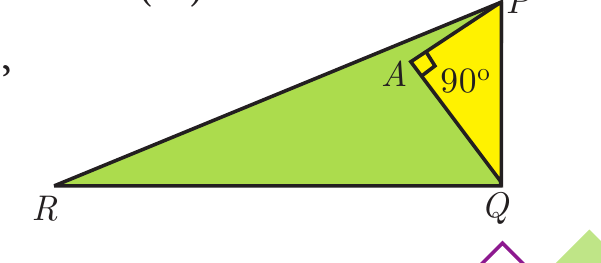

---
choices:
  - $80^\circ$
  - $85^\circ$
  - $75^\circ$
answers:
  - $90^\circ$
---

## In the given figure, $PR=26$ cm, $QR=24$ cm, $\angle PAQ=90^\circ$, $PA=6$ cm and $QA=8$ cm. Find $\angle PQR$

---

#### In right-angled triangle $\triangle PAQ$, with $\angle PAQ = 90^\circ$, by the Pythagorean theorem:
$$PQ^2 = PA^2 + QA^2 = 6^2 + 8^2 = 36 + 64 = 100 \implies PQ = 10\text{ cm}$$
In $\triangle PQR$, the lengths of the three sides are $PQ = 10\text{ cm}$, $QR = 24\text{ cm}$, and $PR = 26\text{ cm}$.
Checking the Pythagorean relation:
$$PQ^2 + QR^2 = 10^2 + 24^2 = 100 + 576 = 676$$
$$PR^2 = 26^2 = 676$$
Since $PQ^2 + QR^2 = PR^2$, by the converse of Pythagoras theorem, $\triangle PQR$ is a right-angled triangle with the right angle opposite to hypotenuse $PR$.
Therefore, $\angle PQR = 90^\circ$.
