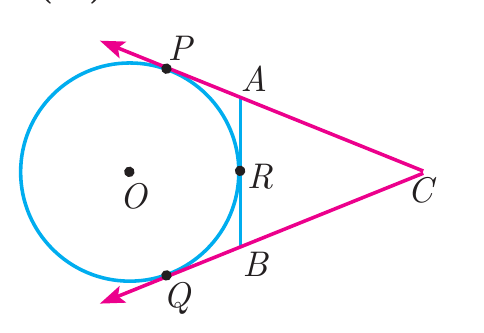

---
choices:
  - $6$ cm
  - $5$ cm
  - $8$ cm
answers:
  - $4$ cm
---

## In figure $CP$ and $CQ$ are tangents to a circle with centre at $O$. $ARB$ is another tangent touching the circle at $R$. If $CP=11$ cm and $BC=7$ cm, then the length of $BR$ is

---

#### Tangents drawn from an external point to a circle are equal in length.
From point $C$, the tangents are $CP$ and $CQ$:
$$CQ = CP = 11\text{ cm}$$
From the figure, point $B$ lies on the tangent segment $CQ$, so:
$$CQ = BC + BQ \implies 11 = 7 + BQ \implies BQ = 11 - 7 = 4\text{ cm}$$
From the external point $B$, tangents to the circle are $BQ$ and $BR$, which are equal:
$$BR = BQ = 4\text{ cm}$$
