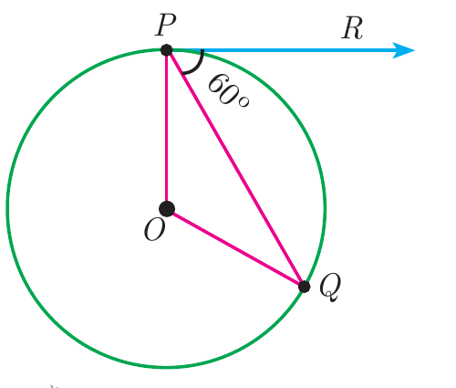

---
choices:
  - $100^\circ$
  - $110^\circ$
  - $90^\circ$
answers:
  - $120^\circ$
---

## படத்தில் உள்ளவாறு $O$-வை மையமாகக் கொண்ட வட்டத்தின் தொடுகோடு $PR$ எனில், $\angle POQ$ ஆனது

---

#### தொடுபுள்ளி $P$-யில் ஆரம் $OP$ ஆனது தொடுகோடு $PR$-க்குச் செங்குத்தாகும்:
$$\angle OPR = 90^\circ$$
படத்திலிருந்து $\angle QPR = 60^\circ$. எனவே:
$$\angle OPQ = \angle OPR - \angle QPR = 90^\circ - 60^\circ = 30^\circ$$
$OP = OQ$ (ஒரே வட்டத்தின் ஆரங்கள்) என்பதால், $\triangle OPQ$ ஓர் இருசமபக்க முக்கோணமாகும்:
$$\angle OQP = \angle OPQ = 30^\circ$$
முக்கோணம் $\triangle OPQ$-யில் மூன்று கோணங்களின் கூடுதல் $180^\circ$:
$$\angle POQ = 180^\circ - (\angle OPQ + \angle OQP) = 180^\circ - (30^\circ + 30^\circ) = 180^\circ - 60^\circ = 120^\circ$$
