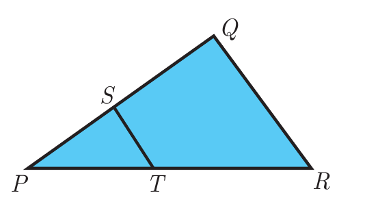

---
choices:
  - "$25:7$"
  - "$25:11$"
  - "$25:13$"
answers:
  - "$25:4$"
---

## கொடுக்கப்பட்ட படத்தில் $ST \parallel QR$, $PS=2$ செ.மீ மற்றும் $SQ=3$ செ.மீ. எனில், $\triangle PQR$-யின் பரப்பளவுக்கும் $\triangle PST$-யின் பரப்பளவுக்கும் உள்ள விகிதம்

---

#### $\triangle PQR$-யில் $ST \parallel QR$ என்பதால், கோ-கோ விதிப்படி $\triangle PST \sim \triangle PQR$ வடிவொத்தவை ஆகும்.
பக்கம் $PQ$-வின் நீளம்:
$$PQ = PS + SQ = 2 + 3 = 5\text{ செ.மீ}$$
இரு வடிவொத்த முக்கோணங்களின் பரப்பளவுகளின் விகிதமானது, அவற்றின் ஒத்த பக்கங்களின் வர்க்கங்களின் விகிதத்திற்குச் சமமாகும்:
$$\dfrac{\text{பரப்பளவு}(\triangle PQR)}{\text{பரப்பளவு}(\triangle PST)} = \left(\dfrac{PQ}{PS}\right)^2 = \left(\dfrac{5}{2}\right)^2 = \dfrac{25}{4} = 25:4$$
