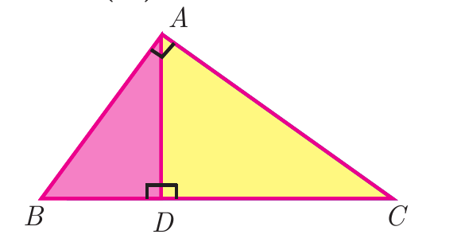

---
choices:
  - $BD\cdot CD=BC^2$
  - $AB\cdot AC=BC^2$
  - $AB\cdot AC=AD^2$
answers:
  - $BD\cdot CD=AD^2$
---

## கொடுக்கப்பட்ட படத்தில் $\angle BAC=90^\circ$ மற்றும் $AD \perp BC$ எனில்,

---

#### $\angle BAC = 90^\circ$ மற்றும் $AD \perp BC$ கொண்ட செங்கோண முக்கோணம் $\triangle ABC$-யில், செங்கோண உச்சியிலிருந்து கர்ணத்திற்கு வரையப்படும் குத்துக்கோடு $AD$ ஆனது முக்கோணத்தை இரு வடிவொத்த முக்கோணங்களாகப் பிரிக்கிறது:
$$\triangle DBA \sim \triangle DAC$$
வடிவொத்த முக்கோணங்களின் ஒத்த பக்கங்களின் விகிதங்கள் சமம் என்பதால்:
$$\dfrac{BD}{AD} = \dfrac{AD}{CD} \implies AD^2 = BD \cdot CD \implies BD \cdot CD = AD^2$$
